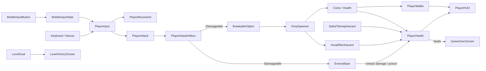
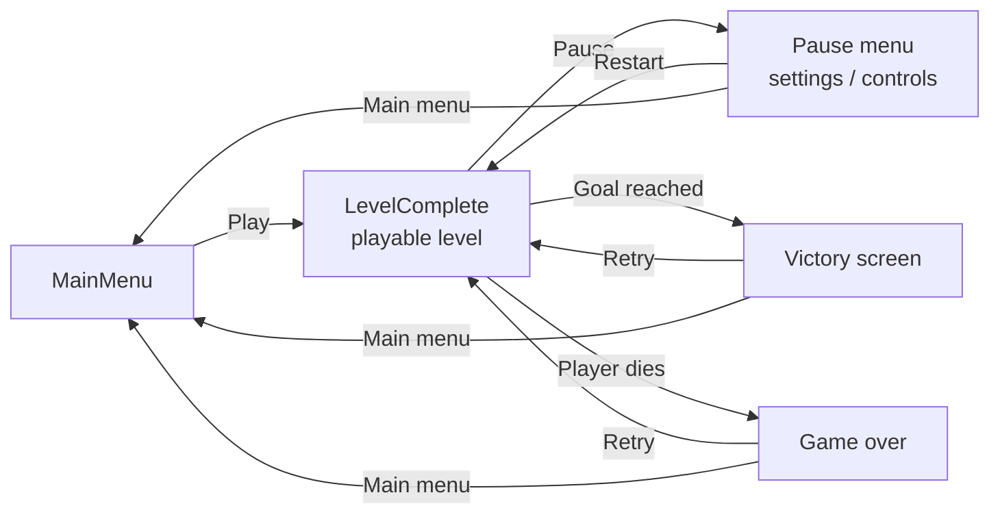

# PiggyPocket


**PiggyPocket** is a 2D action mini-platformer built with Unity 6 and the Universal Render Pipeline (2D Renderer). The player crosses a short level, collects coins, breaks barrels for random drops, fights or stomps enemies, avoids traps and reaches the final goal.

It was built as a portfolio prototype with two goals in mind: tight, readable platforming mechanics, and a codebase split into small, single-purpose components that can be reused for new enemies, hazards and levels. It runs on keyboard/mouse and on touch screens, targeting WebGL and Android.

> Gameplay recording: [`Media/GameplayePiggyPocket.mp4`](Media/GameplayePiggyPocket.mp4)

---

## Table of contents

- [Features](#features)
- [Tech stack](#tech-stack)
- [Architecture](#architecture)
- [Project structure](#project-structure)
- [Getting started](#getting-started)
- [Controls](#controls)
- [Building](#building)
- [Editor tooling](#editor-tooling)
- [Project status](#project-status)
- [Credits](#credits)
- [Author](#author)

---

## Features

### Player
- Horizontal movement and jumping with **coyote time** (0.2 s grace window after leaving a ledge).
- Melee attack with a **two-hit combo**: a second input during the first hit queues the follow-up, each hit with its own timed hitbox window.
- Health system with **invulnerability frames**, **knockback**, hurt and death states.
- **Poison** status effect applied by enemies and hazards.
- Coin wallet that feeds the HUD.

### Enemies
- Abstract `EnemyBase` with configurable health, contact damage (optionally side-only), poison on hit and an automatic hit-flash/scale feedback.
- **Patrol movement**, **stomp-to-damage** detection from above and a dedicated animator component.
- Current concrete enemy: a caterpillar (`OrugaEnemy`) built on top of the base class.

### World and objects
- **Collectibles**: bronze and gold coins with different values (with a collect VFX) and health pickups.
- **Breakable barrels** with a `DropSpawner` that can release health, coins, a bomb or a poison potion.
- **Area hazards** (bomb, poison potion) that trigger after a delay or on player contact and apply damage and/or poison in a radius.
- **Spike traps** painted directly on a Tilemap with the Tile Palette.
- Level goal, 2D camera follow and multi-layer **parallax** background.

### UI, audio and platform
- HUD with health and coins, plus pause, settings (volume and mute persisted with `PlayerPrefs`), controls help, victory and game-over screens.
- Main menu scene.
- On-screen **touch controls** (left, right, jump, attack, pause), shown automatically on touch devices and WebGL with touch support.
- Centralized audio manager for background music and SFX (jump, attacks, damage, coins, explosions, poison, UI clicks, victory and defeat).
- Mobile performance bootstrap: on mobile platforms the game switches to the `Low` quality level, disables VSync and targets 60 FPS before the first scene loads.

---

## Tech stack

| Area | Technology |
|---|---|
| Engine | Unity `6000.3.5f2` (Unity 6) |
| Language | C# (MonoBehaviour components) |
| Rendering | Universal Render Pipeline 17.3 with 2D Renderer and 2D lights |
| 2D tooling | 2D Animation, Sprite, Tilemap + Tilemap Extras, Aseprite and PSD importers |
| Camera | Cinemachine 3.1 (main level), custom `CameraFollow2D` (generated scenes) |
| UI | uGUI + TextMesh Pro |
| Input | Unity Input Manager API (`Input.GetAxisRaw`, `GetButtonDown`) plus a custom touch input layer |
| Targets | WebGL, Android (`com.enzodev.piggypocket`) |
| IDE support | Visual Studio / VS Code (Unity debugger attach), Rider |

---

## Architecture

The gameplay code follows a **component-based** design: each script has one responsibility and communicates with others through public properties, `RequireComponent` dependencies and a shared damage contract.

### Key design decisions

- **Input decoupled from movement.** `PlayerInput` only reads keyboard, mouse and touch, merging them into three values (`MovimientoHorizontal`, `SaltoPresionado`, `AtaquePresionado`). It runs with `[DefaultExecutionOrder(-100)]` so movement and attack always read fresh input in the same frame. Touch buttons write into a static `MobileInputState`, so the rest of the game is unaware of the input source.
- **Shared damage contract.** Anything that can be hit implements `IDamageable.RecibirDano(amount, hitPoint, attacker)`. The player hitbox damages enemies and breakables without knowing their concrete type.
- **Template-method enemies.** `EnemyBase` implements health, death, contact damage and status effects with `protected virtual` hooks (`AlRecibirDano`, `AlMorir`, `ActualizarEnemigo`). New enemies inherit and combine behaviours such as `EnemyPatrolMovement` or `EnemyStompReceiver`.
- **Data-driven hazards and drops.** `AreaEffectHazard` and `DropSpawner` are configured from the Inspector, so a bomb, a poison potion or a new barrel is a prefab variation, not new code.
- **Centralized audio.** `GameAudioManager` exposes static methods (`ReproducirSalto()`, `ReproducirMoneda()`, …) backed by a single instance, so gameplay scripts trigger sounds without holding references.

### Gameplay flow



### Scene flow



---

## Project structure

```text
PiggyPocket/
├── Assets/
│   ├── Anim/          # Animation clips and Animator Controllers (player, enemies, items, hazards)
│   ├── Editor/        # Editor tools that generate scenes, HUD prefab, parallax and tile setups
│   ├── Fonts/         # Game font and its TextMesh Pro SDF asset
│   ├── Prefabs/       # Player, enemy, collectibles, breakables, hazards, goal and HUD prefabs
│   ├── Scenes/        # Main menu, playable level and isolated test scenes
│   ├── Scrips/        # Gameplay source code (C#)
│   │   ├── Audio/         # GameAudioManager
│   │   ├── Breakables/    # BreakableObject, DropSpawner
│   │   ├── Collectibles/  # CoinCollectible, LifeCollectible
│   │   ├── Enemigos/      # EnemyBase and enemy behaviour components
│   │   ├── Hazards/       # Area, spike tilemap and ground-activated hazards
│   │   ├── Level/         # LevelGoal, CameraFollow2D, ParallaxBackgroundLayer
│   │   ├── Player/        # Input, movement, attack, health, status effects, wallet
│   │   ├── UI/            # HUD, menus, end screens and touch controls
│   │   ├── IDamageable.cs
│   │   └── MobilePerformanceSettings.cs
│   ├── Settings/      # URP asset, 2D Renderer and build profiles
│   ├── Sound/         # Music and sound effects
│   ├── Sprites/       # Characters, tiles, UI and mobile control sprites
│   └── Tilemap/       # Tile palettes, ground tiles, vegetation and spike traps
├── Build/Web/         # Prebuilt WebGL build
├── Media/             # Gameplay recording
├── Packages/          # Unity package manifest
└── ProjectSettings/   # Unity project configuration
```

### Scenes

| Scene | Purpose | In build |
|---|---|---|
| `MainMenu.unity` | Entry point and main menu | Yes |
| `LevelComplete.unity` | Full playable level loaded from the main menu | Yes |
| `Level_01.unity`, `MetaFinal.unity` | Scenes generated and used by the editor tools | No |
| `Player`, `Enemy`, `Collectibles`, `Barrels`, `SampleScene` | Isolated sandboxes to test each system | No |

---

## Getting started

### Prerequisites

- [Unity Hub](https://unity.com/download)
- Unity Editor **6000.3.5f2** (other Unity 6 patch versions may work but are untested)
- Optional build modules:
  - **Web Build Support** for WebGL builds
  - **Android Build Support** (with OpenJDK and Android SDK/NDK) for APK builds

### Run in the editor

1. Clone the repository:
   ```bash
   git clone https://github.com/EnzoDalmasso/PiggyPocket.git
   ```
2. Open Unity Hub, choose **Add project from disk** and select the cloned folder. Unity restores the packages listed in `Packages/manifest.json` on first open.
3. Open `Assets/Scenes/MainMenu.unity`.
4. Press **Play**.

Touch controls are also visible in the editor by default, so the mobile layout can be tested without a device.

### Run the included WebGL build

`Build/Web` contains a compressed WebGL build. Browsers block it when opened from `file://`, so serve the folder over HTTP, for example:

```bash
npx http-server Build/Web
```

The build files use the `.unityweb` extension; if the page fails to load, rebuild with **Decompression Fallback** enabled or use a server configured to send the matching `Content-Encoding` header.

---

## Controls

| Action | Keyboard / Mouse | Touch |
|---|---|---|
| Move | `A` / `D` or arrow keys | Left / right buttons |
| Jump | `Space` | Jump button |
| Attack (tap twice for combo) | `J` or left click | Attack button |
| Pause | `Esc` or `P` | Pause button |

Left clicks over UI elements are ignored by the attack input, so menu interaction never triggers an attack.

---

## Building

Open **File › Build Profiles**, select the target platform, click **Switch Platform** and then **Build** (or **Build And Run**). The build includes the scenes `MainMenu` and `LevelComplete`.

| Setting | Value |
|---|---|
| Product name | `PiggyPocket` |
| Company name | `EnzoDev` |
| Android package | `com.enzodev.piggypocket` |
| Version | `1.0.0` |

On Android, `MobilePerformanceSettings` applies the mobile quality preset automatically at startup; no extra configuration is required.

---

## Editor tooling

The project adds a **PiggyPocket** menu to the Unity Editor with scripts in `Assets/Editor` that automate repetitive setup:

| Menu | What it does |
|---|---|
| `PiggyPocket › Scenes › Generate Main Menu` | Builds the main menu scene from code |
| `PiggyPocket › Scenes › Configure Build Scenes` | Writes a build scene list (`MainMenu` + `Level_01`) |
| `PiggyPocket › Levels › Generate Level 01` | Generates the `Level_01` scene |
| `PiggyPocket › UI › Rebuild HUD Canvas` | Regenerates the HUD canvas prefab |
| `PiggyPocket › UI › Aplicar Panel Controles …` | Applies the controls help panel to the menu and HUD |
| `PiggyPocket › Level › Crear / Reparar Fondo Parallax` | Creates or repairs the parallax background |
| `PiggyPocket › Level › Preparar / Reparar / Limpiar Trampas Spike` | Sets up the spike trap tilemap |
| `PiggyPocket › Level › Agregar Vegetacion A Tile Palette` | Adds vegetation tiles to the Tile Palette |

> Running **Configure Build Scenes** replaces the current build list (which ships `LevelComplete`) with `Level_01`. Review **Build Profiles › Scene List** afterwards.

---

## Project status

Playable prototype with one complete level. Planned improvements:

- Final visual design for the menus.
- Additional levels and enemy types.
- Difficulty balancing.
- Public WebGL and Android releases.

---

## Credits

Third-party assets:

- Player, enemies, barrels, health, coins, vegetation and tileset: [Berie's Adventure Seaside](https://crusenho.itch.io/beriesadventureseaside) by crusenho
- UI: [Gold 2D Mobile UI for Casual Game](https://cga-creative-game-assets.itch.io/gold-2d-mobile-ui-for-casual-game) by CGA Creative Game Assets
- Mobile controls: [Mobile Controls](https://opengameart.org/content/mobile-controls) on OpenGameArt

Music and sound effects were added for the prototype.

---

## License

Source code released under the [MIT License](LICENSE). Third-party assets keep the license of their original authors.

---

## Author

**Enzo Dalmasso**

- GitHub: [@EnzoDalmasso](https://github.com/EnzoDalmasso)
- Portfolio: [porfolio-enzo-dalmasso.vercel.app](https://porfolio-enzo-dalmasso.vercel.app/)
